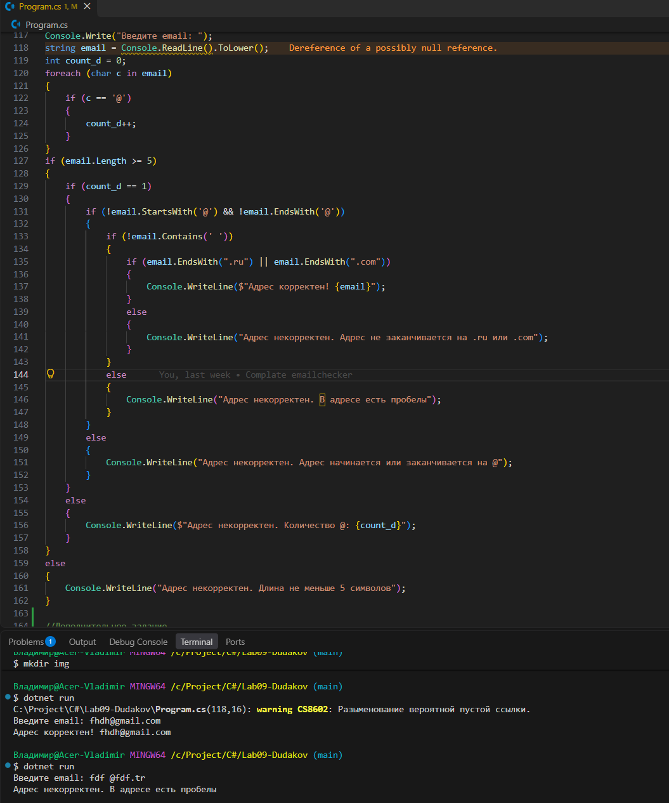
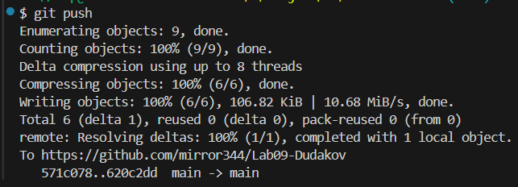

# Практическая работа №9
**ФИО:** Дудаков Иван\
**Группа:** ИСП-241\
**Дата:** 30.10.2026
## Что изучено
- Строку нельзя изменить «по месту»: `word[0] = 'К'` даст ошибку.
- Символ (char) записывается водинарных кавычках: `'а'`, а строка — в двойных: `"а"`
- text.ToUpper() без записи результата в переменную ничего не меняет, так как строки яляются неизменяемыми

## Скриншоты

